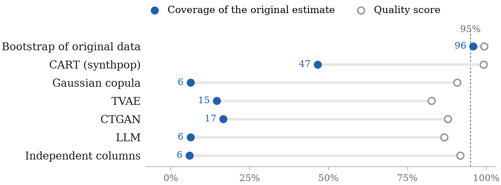

# synthrep

Code and results for "Do Regressions on Synthetic Data Match the Original? Evidence from the GSS and the ACS" by Brandon Yee and Jacob Crainic. The extended abstract is in `paper/abstract.tex` and `paper/abstract.pdf`.

We make synthetic copies of two public surveys, rerun 32 regression coefficients of the kind found in published work on each copy, and check whether they match the estimates from the original data.



## Data

- General Social Survey (GSS) cumulative file 1972-2024, release R3a (NORC): 62,472 respondents with no missing values on 12 variables.
- 2022 American Community Survey (ACS) 1-year public-use file, Pennsylvania: 46,543 wage earners aged 25-64, 11 variables.

`scripts/get_data.py` downloads both files. No login is needed and the raw data are not included here. If NORC has changed the GSS file since release R3a, results can differ slightly.

## Methods

| Name in code | Method | Files per survey |
|---|---|---|
| `bootstrap` | resample of the original rows (reference) | 10 |
| `marginals` | each column resampled on its own, "independent columns" (reference) | 10 |
| `synthpop` | sequential CART with the R package `synthpop` | 10 |
| `copula` | Gaussian copula from the Synthetic Data Vault (SDV) | 10 |
| `tvae300` | TVAE from SDV, 300 epochs | 3 |
| `ctgan300` | CTGAN from SDV, 300 epochs | 3 |
| `llm` | Gemini 2.5 Flash-Lite through OpenRouter, shown a codebook and 40 original rows per request | 3 |

The regressions are 16 least-squares models with robust standard errors (`synthrep/analyses.py`). Derived variables are computed after synthesis. Further checks rebuild nine coefficients from three published papers (`synthrep/published.py`), use subsamples of 2,000 and 10,000 records (`synthrep/scale.py`), and refit with survey weights and design-based standard errors (`synthrep/extra.py`, `synthrep/design.py`).

`synth_results/estimates.jsonl` and `summary.md` also hold three earlier runs that the paper does not report: `cart` (a Python CART), `tvae` (150 epochs) and `ctgan` (100 epochs).

## Results

| Synthetic file | Same significance as original | Coverage of original estimate | SDV quality score |
|---|---|---|---|
| Bootstrap of original data | 97% | 96% | 99% |
| CART (`synthpop`) | 91% | 47% | 99% |
| Gaussian copula | 72% | 6% | 91% |
| TVAE | 93% | 15% | 83% |
| CTGAN | 88% | 17% | 88% |
| LLM | 83% | 6% | 87% |
| Independent columns | 5% | 6% | 92% |

Coverage is the share of synthetic 95% intervals that contain the original estimate, pooled over the 32 coefficients. Full tables are in `synth_results/summary.md`.

## Check your own synthetic files

`synthrep/check.py` reports, for a list of regressions, the original estimate, the combined synthetic estimate, the coverage of single-file intervals, whether the combined interval contains the original estimate, and the pMSE ratio of each synthetic file.

```bash
python -m synthrep.check original.csv syn1.csv syn2.csv --spec regressions.json --out report.csv
```

`regressions.json` is a list such as `[{"formula": "y ~ x + C(g)", "terms": ["x"], "weights": "w"}]`; `weights` is optional. A worked example after `scripts/reproduce.sh` has run:

```bash
python -m synthrep.check data/csv/acs.csv data/sp/acs_0.csv data/sp/acs_1.csv --spec examples/acs_regressions.json
```

## Reproduce

This needs Python 3.12, R with `synthpop`, and several hours on a CPU. The LLM steps run only when `OPENROUTER_API_KEY` is set, and they cost money.

```bash
python -m venv .venv && source .venv/bin/activate
pip install -r requirements.txt
bash scripts/reproduce.sh
```

`scripts/reproduce.sh` lists every step: download, synthesis, regressions, the checks, `synthrep.analyze` (writes `summary.md`, `metrics.csv`, `combined.csv`), the quality scores (`fidelity.csv`) and the figure. Each step skips results that are already in its `.jsonl` file in `synth_results/`, so delete that file to rerun the step from scratch. `synth_results/` holds the outputs used in the paper.

## Data citations

- Davern, M., Bautista, R., Freese, J., Herd, P., & Morgan, S. L. General Social Survey 1972-2024. NORC at the University of Chicago.
- U.S. Census Bureau, American Community Survey 2022 1-year Public Use Microdata Sample.

Code: https://github.com/Nyxius-Labs/synthrep. License: MIT (see `LICENSE`).
