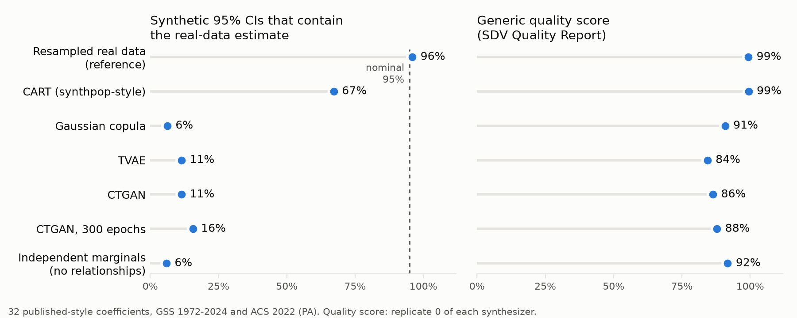

# Right Direction, Wrong Answer: Do Published Social-Science Results Survive AI-Generated Synthetic Data?

*Nyx(ius) Labs. Extended abstract (draft)*

## 1. Motivation
Synthetic microdata, produced by generative models trained on confidential records, are moving into
the infrastructure of social science:
- The Census Bureau has released synthetic SIPP and LBD files.
- Statistics agencies and data archives are piloting synthetic releases.
- Commercial tools (SDV, Gretel, MOSTLY AI) let any researcher make a "shareable copy" of restricted data.

The promise is that analysts can run their usual models on the synthetic file and get the same answers.
Releasers mostly certify synthetic data with **generic fidelity scores**: marginal distributions, pairwise
correlations, discriminator tests. These scores say nothing directly about the quantities social scientists
publish, such as regression coefficients, interactions, subgroup gaps, trends and fixed-effects estimates.

We ask a simple question with real stakes for replication and data access: **when a published-style analysis
is rerun on AI-generated synthetic data, does it reproduce the original estimate, and can the analyst tell?**

## 2. Design
**Real data, public and real.**
- The General Social Survey cumulative file, 1972–2024 (n = 62,472; 12 variables; sociology).
- The 2022 ACS PUMS for Pennsylvania wage earners aged 25–64 (n = 46,543; 11 variables; labor economics).

**Synthesizers** (non-text generative models, all run on a CPU):
- sequential CART (the synthpop default used by statistical agencies)
- Gaussian copula
- CTGAN and TVAE (deep generative models)
- *two anchors:* resampled real data, which shows sampling noise only, and independent marginals, which keep every variable's distribution but no relationships between them

There are 10 replicate synthetic files per synthesizer: 3 each for CTGAN and TVAE, plus a 300-epoch CTGAN check.

**Estimands.** 32 coefficients from 16 models of the kind found in published work. Each is tagged by type:
- **main effects:** returns to schooling, the gender wage gap, the marriage–income gradient
- **nonlinear terms:** age², experience²
- **fixed-effects-adjusted:** occupation, PUMA, region and year fixed effects
- **trends:** declining female happiness (Stevenson & Wolfers 2009), religious attendance by birth cohort
- **interactions:** female × education, Black × BA, married × female
- **subgroup estimates:** the gender gap among Asian and Black workers, the Black–white income gap in the 1970s versus the 2010s

Derived variables are built *after* synthesis, as a user of a released file would.

**Metrics.**
- CI overlap (Karr et al. 2006)
- standardized bias
- coverage: whether the synthetic 95% CI contains the real estimate
- agreement on sign and significance
- the pooled-copies test of Raab, Nowok & Dibben (2016)
- generic fidelity: the SDV Quality Report score and the pMSE ratio (Snoke et al. 2018), compared against analysis-level validity

## 3. Pilot results (completed; ~2 CPU-hours)
| synthesizer | synthetic CI contains real estimate | significance verdict matches | median effect size relative to real (main effects) | SDV quality score |
|---|---|---|---|---|
| resampled real data (reference) | 96% | 97% | 1.00 | 99% |
| CART | 67% | 93% | 1.00 | 99% |
| Gaussian copula | 6% | 72% | 0.75 | 91% |
| TVAE | 11% | 91% | 0.81 | 84% |
| CTGAN (100 / 300 epochs) | 11% / 16% | 82% / 84% | 0.68 / 0.76 | 86% / 88% |
| independent marginals (floor) | 6% | 5% | 0.00 | 92% |

**Finding 1: right direction, wrong answer.**
- The deep generative and copula synthesizers reproduce the *significance verdict* of 72–91% of coefficients.
- They reproduce the *estimate itself* for only 6–16%. Main effects shrink to 68–81% of their true size.
- Some relationships vanish entirely. The copula synthesizer turns the marriage–income gradient from 0.67 to 0.00.
- A researcher checking only "is it still significant?" would wrongly conclude the synthetic file works.
- Training CTGAN for its default 300 epochs barely helps (16% vs 11%), so undertraining doesn't explain it.

**Finding 2: even the best synthesizer gives overconfident inference.**
- CART recovers point estimates on average: median effect ratio 1.00, median bias 1.5 SE.
- Its CIs are as narrow as the real data's, so they contain the real estimate only 67% of the time, against a nominal 95% (79% for the GSS, 54% for the ACS).
- Failures concentrate in fixed-effects-adjusted coefficients (50% coverage) and nonlinear terms (60%).
- Pooling 10 synthetic copies with the standard combining rule does not fix it. 33–80% of coefficients still differ from the real estimate beyond synthesis noise, against 5% expected.

**Finding 3: the generic quality score cannot detect any of this.**
- The SDV Quality Report gives the *independent-marginals* file, in which every relationship has been destroyed, a score of 92%.
- That is *higher* than TVAE (84%) and CTGAN (86–88%).
- Across the 14 synthesizer-by-dataset files, the score's rank correlation with CI overlap is only 0.52.
- A discriminator-based measure (pMSE) does better (−0.66), but neither speaks to whether a specific analysis is valid.

## 4. Contribution
1. **An analysis-level benchmark for synthetic social-science data.**
   - Real public datasets and a battery of published-style estimands tagged by type.
   - Reference and floor anchors, released as reusable open code: any synthesizer can be dropped in.
2. **A substantive warning.**
   - Synthetic files certified by generic fidelity scores can reproduce significance stars while distorting effect sizes, especially for fixed-effects, nonlinear, interaction and subgroup estimates.
   - These are exactly the quantities social scientists publish.
3. **A practical protocol for releasers and users.** Report analysis-specific validity (coverage and CI overlap on a declared battery of estimands) alongside, or instead of, generic quality scores.
   - This connects to the workshop's themes of validating AI-generated data and of replication.

**By April:**
- R `synthpop` itself, alongside our Python CART approximation
- privacy-protected synthesizers (DP-CTGAN, smoothed CART), to map the privacy–validity frontier
- more datasets: CPS, and a Dataverse archive of published replication files using their own models
- survey weights
- a preregistered full run with more replicates of the deep models

*Requested format: lightning talk or talk; poster acceptable.*

